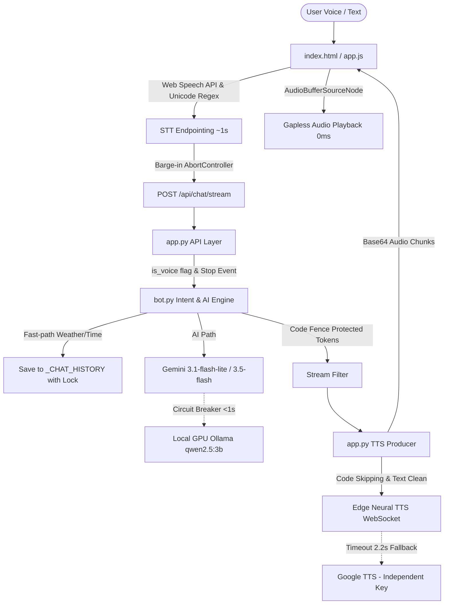

# Project: Wisp Assistant - Conversation Flow Improvements (P0, P1, P2)

## Architecture
Wisp Assistant is a local web-based voice & chat assistant running on Windows.
- **Backend**: Python 3.11+ / Flask (`app.py`), conversational AI & intent engine (`bot.py`), weather lookup (`weather.py`), persistent profile (`user_profile.json`).
- **Frontend**: Vanilla HTML5, CSS3, JavaScript (`templates/index.html`, `static/app.js`, `static/style.css`).
- **Audio & Voice Pipeline**: Edge Neural TTS WebSocket primary with safe Google TTS fallback; Web Audio API (`AudioBufferSourceNode`) gapless playback; Web Speech API SpeechRecognition with adaptive endpointing.
- **AI Inference Engine**: Google Gemini API (streaming) with fast failover (<1s) to Local GPU Ollama (`qwen2.5:3b`).



---

## Feature Inventory
| # | Feature | Description | Milestone | Status | Source |
|---|---------|-------------|-----------|--------|--------|
| F01 | Edge TTS Primary Engine | Eliminate 0.26s race; use Edge Neural TTS as primary with 1 retry and 2.2s safe timeout | M1 (P0) | **DONE** | Survey & Audit §1.1 |
| F02 | Safe TTS Audio Cache | Never cache Google TTS female voice under male voice keys (`namminh`) | M1 (P0) | **DONE** | Survey & Audit §1.1 |
| F03 | Gapless Audio Playback | Web Audio API `AudioBufferSourceNode` 0ms seamless chunk transition | M1 (P0) | **DONE** | Survey & Audit §1.5 |
| F04 | Client Barge-in Control | `AbortController` in `sendMessage`, instant mic reactivation upon interruption | M1 (P0) | **DONE** | Survey & Audit §1.2 |
| F05 | Server Stream Cancellation | `stop_event` in Flask `api_chat_stream` generator to cancel workers immediately on disconnect | M1 (P0) | **DONE** | Survey & Audit §1.2 |
| F06 | Interruption Controls | UI Stop button, Space/Escape hotkeys, tab switch cleanup | M1 (P0) | **DONE** | Survey & Audit §1.2 |
| F07 | Conversational Voice Prompt | Pass `is_voice=True` to `stream_reply`, enforce 1-3 sentences, natural spoken Vietnamese, no markdown bullets/code | M1 (P0) | **DONE** | Survey & Audit §1.3 |
| F08 | Fast-Path History Persistence | Store all fast-path commands (weather, time, date, greetings) in `_CHAT_HISTORY` | M1 (P0) | **DONE** | Survey & Audit §2.1 |
| F09 | Thread-Safe History | Wrap `_CHAT_HISTORY` reads, writes, and clears in `threading.Lock()` | M1 (P0) | **DONE** | Survey & Audit §2.1 |
| F10 | Fast AI Circuit Breaker | Remove invalid `gemini-3.8-flash`; network failure fast failover (<1s) to local GPU Ollama (`qwen2.5:3b`) | M1 (P0) | **DONE** | Survey & Audit §3.1 |
| F11 | STT Endpointing Optimization | Endpointing timer ~950-1150ms after `isFinal`; remove `không`, `chưa`, `đi`, `ơi` from incomplete speech regex | M2 (P1) | **DONE** | Survey & Audit §1.4 |
| F12 | Unicode Lookaround in JS | Replace ASCII `\b` with Unicode lookaround `(?<![\p{L}\p{N}_])...(?![\p{L}\p{N}_])` `/u` in `app.js` | M2 (P1) | **DONE** | Survey & Audit §1.4 |
| F13 | STT Keyword Scoring Dampening | Lower keyword bonus from +5.0 to +0.8 to prevent false ranking overwrites | M2 (P1) | **DONE** | Survey & Audit §1.4 |
| F14 | Dynamic User Profile Name | Eliminate hardcoded "Nguyên"; dynamic sync with `user_profile.json` ("Duy Khánh"); SSR topbar render | M2 (P1) | **DONE** | Survey & Audit §2.2 |
| F15 | User Profile Gender Field | Add `gender: "Nam"` to `user_profile.json`, model defaults, prompt builder, and UI popover | M2 (P1) | **DONE** | Survey & Audit §2.2 |
| F16 | Code Fence Token Protection | Disable pronoun transformations inside code fences (`in_code_fence == True`) during streaming | M2 (P1) | **DONE** | Survey & Audit §2.2 |
| F17 | Stream End Jitter Elimination | Control length from System Prompt; prevent done event from truncating rendered/spoken text | M2 (P1) | **DONE** | Survey & Audit §2.2 |
| F18 | World Clock Intent Fix | Remove single-token ambiguous keys ("anh", "nhat", "my"); require clear country phrasing | M2 (P1) | **DONE** | Survey & Audit §2.3 |
| F19 | Weather Topic Substring Fix | Replace raw substring matches ("nang", "mat", "mua") with bounded accented word matching | M2 (P1) | **DONE** | Survey & Audit §2.3 |
| F20 | Temperature Query & Alias Fix | Support "bao nhiêu độ"; add "phu quoc" to `CITY_ALIASES`; sanitize advisory suffixes from city names | M2 (P1) | **DONE** | Survey & Audit §2.3 |
| F21 | Code-First Intent Precision | Tighten Code-First trigger conditions; exclude plain verbs "viết", "tạo", "mẫu", "ham" | M2 (P1) | **DONE** | Survey & Audit §2.3 |
| F22 | Auto-Learn Edge Cases Fix | Require 1st-person subjects; filter travel/vacation temporary stays; fix 1-4 word name parsing; Vietnamese possessive & kinship protection | M2 (P1) | **DONE** | Survey & Audit §2.3 |
| F23 | TTS Code Block Skipping | Skip line-by-line reading of code blocks in `_producer_worker`; read short lead-in phrase | M2 (P1) | **DONE** | Survey & Audit §1.5 |
| F24 | TTS Text Normalization | Sanitize abbreviations ("TP."), spoken currency ("1.500.000.000 đồng" -> "1 phẩy 5 tỷ đồng", "50000 vnđ" -> "50 nghìn đồng"), start-of-line temperatures/negatives, versions ("3.11"), times ("10:00"), URLs | M2 (P1) | **DONE** | Survey & Audit §1.5 |
| F25 | Multiline Code Input | Replace `<input>` with auto-resizing `<textarea>` supporting `Shift+Enter` without mangling code | M3 (P2) | BACKLOG | Survey & Audit §3.2 |
| F26 | Formatted Code Block & Copy | Render `<pre><code>` with copy button; prevent inline code selection from triggering send | M3 (P2) | BACKLOG | Survey & Audit §3.2 |
| F27 | Unified Chat & Voice History | Unify chat and voice message stores; persist in `localStorage` across F5 page reloads | M3 (P2) | BACKLOG | Survey & Audit §3.2 |
| F28 | Synchronized Clear History | Implement bidirectional clear history endpoint `DELETE /api/history` synced with UI | M3 (P2) | BACKLOG | Survey & Audit §3.2 |
| F29 | Profile Popover Auto-Save Fix | Dismiss popover on outside click without saving invalid/partial edits; save only on button click | M3 (P2) | BACKLOG | Survey & Audit §3.2 |
| F30 | Security & Cleanliness (.env) | Remove unused CDN links in `index.html`; isolate `GEMINI_API_KEY` into `.env` / `.env.example` | M3 (P2) | BACKLOG | Survey & Audit §3.2 |
| F31 | Verification & Adversarial Hardening | Comprehensive multi-tier verification (68/68 tests pass repository-wide) | M4 (E2E) | **DONE** | Pattern Dual-Track |

---

## Milestones

| # | Name | Scope | Dependencies | Status | Delivery Artifacts |
|---|------|-------|-------------|--------|-------------------|
| M1 | Voice Core & Flow Resilience (P0) | F01–F10 | Survey completed | **DONE** | `app.py`, `bot.py`, `static/app.js`, `test_m1_verification.py` (23/23 tests pass) |
| M2 | Natural Language & Intent Protection (P1) | F11–F24 | M1 interface contracts | **DONE** | `bot.py`, `app.py`, `static/app.js`, `user_profile.json`, `test_m2_verification.py`, `test_m2_challenger_adversarial.py`, `test_m2_challenger_2_adversarial.py` (68/68 tests pass across repo) |
| M3 | UI Chat/Code & State Synchronization (P2) | F25–F30 | M1, M2 interface contracts | **BACKLOG** | Tạm dừng theo yêu cầu của Người dùng: *"Xong P1 tạm dừng đã nha, đợt 2 tôi sẽ yêu cầu sau"*. Sẵn sàng triển khai trong đợt tiếp theo. |
| M4 | Comprehensive Verification | Verification of all active features (F01–F24) | M1, M2 | **DONE** | 68/68 automated tests passed (100% pass rate, 0 failures, 0 errors). Gate PASS signed off by 2 Reviewers, 2 Challengers, and Forensic Auditor (CLEAN). |

---

## Interface Contracts

### 1. `app.py` ↔ `bot.py`
- `stream_reply(message: str, prefs: dict | None = None, is_voice: bool = False) -> Generator[dict, None, None]`
  - Emits: `{"type": "token", "delta": str}`, `{"type": "audio", "b64": str}` (via producer), `{"type": "done", "reply": str}`.
  - When `is_voice=True`: applies concise conversational voice prompt (1-3 sentences, natural spoken Vietnamese, no markdown bullets/code).
- `get_reply(message: str, prefs: dict | None = None) -> str`
- `_CHAT_HISTORY`: thread-safe via `_CHAT_HISTORY_LOCK = threading.Lock()`.
- Fast-path entries appended via `_append_chat_history(raw, cleaned_reply, is_fast_path=True)`.

### 2. Frontend `app.js` ↔ Backend `app.py`
- `POST /api/chat/stream`: accepts JSON `{"message": str, "speak": bool, "voice": str, "voice_speed": float, "voice_pitch": float, "chat_style": str}`.
  - Supports client abort via `AbortController`.
  - Generator in `app.py` sets `stop_event` on client disconnect.
- `GET /`: SSR renders `user_profile.json` initial values (`name`, `city`, `gender`) in `index.html`.

### 3. TTS Synthesis & Caching Contract
- Engine: Edge Neural TTS primary (`_synthesize_edge_tts`).
- Cache Key: `(voice_id, clean_text)`.
- Fallback: Google TTS called ONLY if Edge TTS errors or times out after 2.2s.
- Google TTS cached under `("google_fallback", clean_text)` — NEVER under `("namminh", ...)` or male profile keys.

---

## Backlog: Milestone M3 (P2: UI Chat/Code & State Synchronization)
*Sẵn sàng thực thi ngay khi người dùng yêu cầu đợt tiếp theo.*

### 1. F25: Multiline Code Input
- **File**: `templates/index.html` & `static/app.js`
- **Mục tiêu**: Đổi ô `<input id="message-input">` thành `<textarea id="message-input" rows="1">`.
- **Hành vi**:
  - Nhấn `Enter` đơn thuần: Gửi tin nhắn.
  - Nhấn `Shift + Enter`: Xuống dòng mới mà không gửi.
  - Tự động co giãn chiều cao (auto-resize) từ 1 dòng đến tối đa 5 dòng (`max-height: 120px; overflow-y: auto`).
  - Xử lý sự kiện `paste` bảo toàn nguyên vẹn thụt lề (indentation) và ký tự ngắt dòng của mã nguồn dán vào.

### 2. F26: Formatted Code Blocks & Copy Button
- **File**: `static/app.js` & `static/style.css`
- **Mục tiêu**: Hiển thị code đẹp mắt, dễ đọc với nút sao chép tiện lợi.
- **Hành vi**:
  - Khi render markdown code fence (```language ... ```), bao bọc trong `<pre><div class="code-header"><span class="code-lang">language</span><button class="copy-btn">Sao chép</button></div><code class="language-...">...</code></pre>`.
  - Click nút `Sao chép`: Gọi `navigator.clipboard.writeText(...)`, đổi nhãn tạm thời thành `"Đã sao chép!"` trong 2 giây rồi trở về trạng thái cũ.
  - Chống xung đột sự kiện: Bôi đen text trong code block không kích hoạt click gửi tin nhắn hay kích hoạt voice orb.

### 3. F27: Unified Chat & Voice History across F5
- **File**: `static/app.js`
- **Mục tiêu**: Đồng bộ toàn bộ mạch hội thoại giữa chế độ Chat văn bản và chế độ Voice đàm thoại.
- **Hành vi**:
  - Lưu trữ tin nhắn trong `localStorage.getItem("wisp_chat_history")`.
  - Khi chuyển qua lại giữa màn hình Chat và màn hình Voice: Không làm trống DOM tin nhắn, cả 2 chế độ đều đọc chung mảng lịch sử.
  - Khi người dùng tải lại trang (F5): Hàm khởi tạo `initHistory()` đọc từ `localStorage` và render lại toàn bộ các bong bóng chat theo đúng thứ tự thời gian.

### 4. F28: Synchronized Clear History Endpoint
- **File**: `app.py` & `static/app.js`
- **Mục tiêu**: Đồng bộ thao tác xóa lịch sử giữa giao diện và backend.
- **Hành vi**:
  - Tạo endpoint `DELETE /api/history` trong `app.py`:
    ```python
    @app.route("/api/history", methods=["DELETE"])
    def api_clear_history():
        bot.clear_chat_history()
        return jsonify({"ok": True, "message": "Đã xóa toàn bộ lịch sử hội thoại"})
    ```
  - Khi người dùng bấm nút "Xóa lịch sử" trên UI hoặc gõ lệnh "xóa lịch sử": Gửi request `DELETE /api/history`, đồng thời xóa `localStorage.removeItem("wisp_chat_history")` và dọn sạch giao diện chat.

### 5. F29: Profile Popover Outside-Click Auto-Save Fix
- **File**: `static/app.js`
- **Mục tiêu**: Sửa lỗi tự động lưu đè cấu hình không mong muốn khi bấm ra ngoài popover.
- **Hành vi**:
  - Hiện tại: Khi click ra ngoài vùng Popover Hồ sơ, hàm đóng popover vô tình kích hoạt lưu đè dữ liệu đang gõ dở.
  - Khắc phục: Khi click ra ngoài popover, chỉ ẩn modal (`popover.classList.remove('active')`) và hoàn tác (revert) các giá trị trong form về trạng thái lưu gần nhất; chỉ lưu và gửi API `POST /api/profile` khi người dùng bấm rõ ràng vào nút "Lưu hồ sơ".

### 6. F30: Security & Cleanliness (.env Isolation)
- **File**: `templates/index.html`, `.env`, `.env.example`, `app.py`
- **Mục tiêu**: Dọn dẹp thư viện thừa và bảo mật khóa API.
- **Hành vi**:
  - Gỡ bỏ liên kết CDN không dùng tại `templates/index.html` dòng 7 (`<link rel="stylesheet" href="https://cdn.jsdelivr.net/...iconsax...">`).
  - Đảm bảo biến `GEMINI_API_KEY` được đọc hoàn toàn từ biến môi trường thông qua `python-dotenv` hoặc `.env` local, không lộ trong mã nguồn. Cung cấp file mẫu `.env.example`.

---

## Code Layout
- `app.py`: Web server, streaming endpoints, TTS pipeline, Web Audio helpers.
- `bot.py`: Multi-turn conversational memory, intent routing, persona filters, AI streaming (Gemini + Local Ollama).
- `weather.py`: Open-Meteo geocoding and forecast queries, city aliases, temperature parser.
- `user_profile.json`: Persistent user profile (name, gender, city, age, height, weight, job).
- `templates/index.html`: App UI, topbar, voice orb stage, textarea chat pane, profile modal.
- `static/app.js`: Client state, Web Audio gapless player, Web Speech API controller, history sync, UI events.
- `static/style.css`: Theme, animations, code block styling, copy button, stop button.
- `.env` / `.env.example`: Secure environment configuration.
- `tests/`: Automated unit & E2E verification test suites (68 tests, 100% pass).
